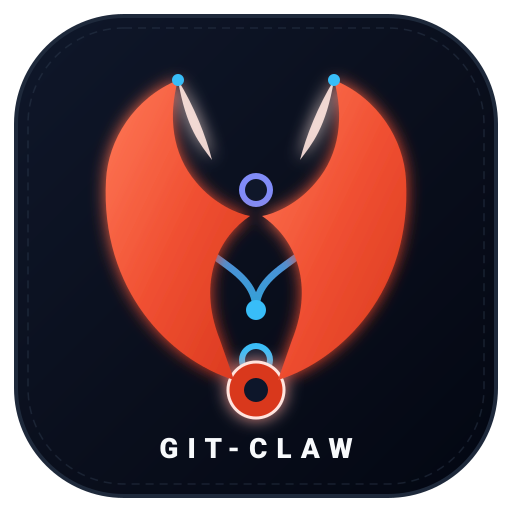

<p align="center">
  
</p>

# git-claw

> Deterministic Git Worktrees orchestrator for concurrent human and AI development.

[](https://crates.io/crates/git-claw)
[](https://github.com/jeremylanes/git-claw/actions)
[](LICENSE)
[](CHEATSHEET.md)

---

## Overview

When developers or autonomous AI coding agents work on multiple Git branches concurrently, traditional in-place branch switching breaks down: local servers collide on ports (`Address already in use`), Docker Compose containers fight over fixed `container_name` values, parallel test runners overwrite each other's databases, and dependencies have to be reinstalled repeatedly.

`git-claw` eliminates this friction through deterministic workspace isolation:

- **Deterministic Slot IDs**: Assigns the lowest available sequential numeric slot (`1, 2, 3...`) per active worktree under an advisory file lock.
- **Collision-Free Port Offsets**: Computes shifted ports deterministically (`Effective Port = Base Port + Slot ID`) while preserving shared client service ports.
- **Per-Slot Test Database Isolation**: Injects `TEST_DATABASE_NAME` and `CLAW_TEST_DB` (`test_<db>_slot_<id>`) into `.env.worktree`, copied `.env` files, and Docker Compose overrides.
- **Docker Compose Interoperability**: Generates `docker-compose.override.yml` automatically, resetting fixed container names (`container_name: !reset`), attaching shared networks, and disabling shared services with `scale: 0`.
- **Environment Auto-Propagation**: Detects and propagates `pyenv` (`.python-version` + `PYENV_VERSION`), `uv`/`venv` (`.venv` symlink + `VIRTUAL_ENV`/`PATH`), `.node-version`, `.nvmrc`, and `.envrc`.
- **Shared Build Caches**: Symlinks heavy dependency directories (`node_modules`, `target`, `.venv`) unless `--isolated` is passed.
- **Machine-Readable `--json` Output**: Emits structured JSON payloads across lifecycle and inspection commands for AI agents and scripts.
- **Auto-Healing Garbage Collection**: Detects manually deleted worktree directories and reclaims stale slots automatically.
- **Release Automation**: Infers SemVer bumps and updates `CHANGELOG.md` and project manifests from Conventional Commits.

**Reference Guide:** Consult the [Markdown Cheatsheet](CHEATSHEET.md) or the visual [HTML Cheatsheet](https://jeremylanes.github.io/git-claw/).

---

## Installation

### Prebuilt Binaries (No Rust Toolchain Required)

Download the archive for your platform from [GitHub Releases](https://github.com/jeremylanes/git-claw/releases), verify the checksum against `SHA256SUMS.txt`, and place `git-claw` on your `PATH`:

```bash
# Example (Linux x86_64 static musl build):
curl -LO https://github.com/jeremylanes/git-claw/releases/latest/download/git-claw-v0.5.0-x86_64-unknown-linux-musl.tar.gz
curl -LO https://github.com/jeremylanes/git-claw/releases/latest/download/SHA256SUMS.txt
sha256sum --ignore-missing -c SHA256SUMS.txt
tar -xzf git-claw-v0.5.0-x86_64-unknown-linux-musl.tar.gz
sudo install -m 0755 git-claw /usr/local/bin/git-claw
```

Available release targets:
- `x86_64-unknown-linux-gnu` (`.tar.gz`)
- `x86_64-unknown-linux-musl` (`.tar.gz`, static binary)
- `aarch64-apple-darwin` (`.tar.gz`, Apple Silicon)
- `x86_64-apple-darwin` (`.tar.gz`, Intel macOS)
- `x86_64-pc-windows-msvc` (`.zip`, Windows)

### Via Cargo

```bash
# Using cargo-binstall (fetches prebuilt binary):
cargo binstall git-claw

# Compile and install from crates.io:
cargo install git-claw

# Or build from local source:
cargo install --path .
```

Verify installation:

```bash
git-claw --version
```

Because the binary is named `git-claw`, Git automatically exposes it as a native subcommand:

```bash
git claw --help
```

---

## Quickstart

```bash
# 1. Inspect project files and generate .git-claw.toml (interactive; pass -y to accept defaults)
git claw init

# 2. Enable optional shell auto-cd integration (bash, zsh, or fish)
eval "$(git claw shell-hook bash)"

# 3. Create an isolated worktree (stays on main by default; pass --cd to jump into it)
git claw feature start auth-flow

# 4. Inspect active slots, paths, and computed ports (human table or JSON)
git claw list
git claw list --json

# 5. Execute commands inside the worktree with .env.worktree injected
git claw run auth-flow npm test

# 6. Publish to remote with upstream tracking
git claw feature publish auth-flow

# 7. Run pre_finish hooks, merge into main, delete local/remote branch, and free the slot
git claw finish auth-flow
```

---

## Command Reference

| Command | Description |
|---|---|
| `git claw init [-y\|--yes] [--json]` | Interactively inspect repo and write `.git-claw.toml` (requires `--yes` with `--json`) |
| `git claw list [--json]` | List active worktrees, assigned slots, computed ports, and HEAD commits |
| `git claw feature start <name> [--isolated] [--cd] [--json]` | Create `feature/<name>` worktree (skip cache symlinks with `--isolated`, auto-cd with `--cd`) |
| `git claw bugfix start <name> [--isolated] [--cd] [--json]` | Create `bugfix/<name>` worktree |
| `git claw hotfix start <name> [--isolated] [--cd] [--json]` | Create `hotfix/<name>` worktree |
| `git claw spike start <name> [--isolated] [--cd] [--json]` | Create disposable `spike/<name>` worktree |
| `git claw spike drop <name> [--json]` | Delete a spike worktree and branch without merging |
| `git claw feature\|bugfix\|hotfix publish [<name>] [--remote <r>] [--json]` | Push typed worktree branch with upstream tracking (inferred from cwd if omitted) |
| `git claw publish [<name>] [--remote <r>] [--json]` | Shorthand to push any active worktree branch to remote |
| `git claw finish [<name>] [--force] [-k\|--keep-remote] [--json]` | Run `pre_finish` hook, merge into `main_branch`, remove worktree/branch, and reclaim slot |
| `git claw open [<name>]` | Open worktree directory in `$EDITOR`, `$VISUAL`, or `code` |
| `git claw run [<name>] <command...>` | Execute a command inside the worktree with `.env.worktree` loaded |
| `git claw cd [<name>]` | Print worktree directory path (supports `main`, `master`, `root`) |
| `git claw tag [<version>]` | Infer SemVer bump and update `CHANGELOG.md`/manifests, or apply explicit tag |
| `git claw shell-hook [shell]` | Output shell integration script (`bash`, `zsh`, `fish`) |
| `git claw completion <shell>` | Output completion script (`bash`, `elvish`, `fish`, `powershell`, `zsh`; alias: `completions`) |

Append `--help` to any command or subcommand for full details.

---

## Configuration (`.git-claw.toml`)

`git-claw` works with zero configuration out of the box (defaulting `worktree_root` to `~/.git-claw/worktrees/<repo_name>`). Configuration merges in order:

1. Built-in defaults
2. Global user config (`~/.git-claw/config.toml`, overrideable via `GIT_CLAW_GLOBAL_CONFIG`)
3. Repository config (`.git-claw.toml`)

Full `.git-claw.toml` schema (all keys match `src/core/config.rs`):

```toml
[project]
main_branch = "main"                               # Default: "main"
worktree_root = "~/.git-claw/worktrees/my-service" # Default: "~/.git-claw/worktrees/<repo_name>"
remote = "origin"                                  # Optional default remote for publish/finish

[ports]
# Shifted deterministically: Effective Port = Base Port + Slot ID
# Keys become PORT_<KEY> unless already PORT, PORT_*, or *_PORT
web = 8000
APP_PORT = 3000

[files]
# Untracked files/directories copied into each new worktree.
# Matched .env files get shifted ports, COMPOSE_PROJECT_NAME, TEST_DATABASE_NAME, and CLAW_TEST_DB.
copy = [".env", "config/local.env"]

[docker]
compose_file = "docker-compose.yml"
network = "my_app_network"
shared_services = ["postgres", "redis"]

[environment]
type = "pyenv"                     # e.g., "pyenv", "uv", "venv"
name = "my-env"                    # Target pyenv version / virtualenv name
copy_files = [".python-version"]   # Extra environment files to propagate

[cache]
strategy = "shared"                # "shared" (symlinks) or "isolated"
directories = [".venv", "node_modules", "target"]

[hooks]
post_start = "bin/up"              # Receives CLAW_SLOT_ID, CLAW_WORKTREE_NAME, CLAW_WORKTREE_PATH, and ports
pre_finish = "cargo test"          # Blocks merge if exit code != 0 (override with --force)
post_finish = "bin/down"           # Runs in primary repository root after cleanup
```

---

## Docker Compose Interoperability & Test DB Isolation

When `[docker]` is configured (or discovered by `git claw init`), every new worktree receives a tailored `docker-compose.override.yml`:

- **Container Name Neutralization**: Applies `container_name: !reset` so parallel worktree stacks never conflict on static container names.
- **Shared Services**: Services listed in `shared_services` are neutralized with `scale: 0`, `restart: "no"`, and `entrypoint: ["true"]` so `depends_on` graphs remain valid while connecting to the single shared database/cache container. Client ports matching shared services (such as `DATABASE_PORT` or `REDIS_PORT`) are not shifted.
- **External Networks & Volumes**: Internal networks and volumes from the base Compose file are marked `external: true`, and `[docker].network` is attached to non-shared services.
- **Per-Slot Test Databases**: Both `.env.worktree` and non-shared Compose service `environment` blocks receive:
  - `TEST_DATABASE_NAME=test_<db>_slot_<slot_id>`
  - `CLAW_TEST_DB=test_<db>_slot_<slot_id>`
  When `[files].copy` includes project `.env` files containing `DATABASE_NAME`, `POSTGRES_DB`, or `MYSQL_DATABASE`, `TEST_DATABASE_NAME` and `CLAW_TEST_DB` are also injected/rewritten in-place inside the copied file.

---

## Environment Auto-Propagation

During `git claw init` and worktree creation (`start`), `git-claw` automatically preserves runtime toolchains:

- **`pyenv`**: Detects `.python-version`, copies it into worktrees, and sets `PYENV_VERSION` in `.env.worktree`.
- **`uv` / `.venv`**: Detects `uv.lock` or `.venv`, symlinks `.venv` (unless `--isolated` is set), and injects `VIRTUAL_ENV` and `PATH` into `.env.worktree`.
- **Node.js & direnv**: Automatically copies `.nvmrc`, `.node-version`, and `.envrc` when present in the primary repository.

---

## Shell Integration & Auto-CD

By default, `start` keeps your current terminal in the primary repository (`main`) so multiplexers or editors can open the worktree independently. Pass `--cd` when you want your active shell to enter the new worktree immediately.

Enable the shell hook in your shell profile:

```bash
# Bash (~/.bashrc):
eval "$(git claw shell-hook bash)"

# Zsh (~/.zshrc):
eval "$(git claw shell-hook zsh)"

# Fish (~/.config/fish/conf.d/git_claw.fish):
git claw shell-hook fish | source
```

With the hook active:
- `git claw feature start my-feat --cd` creates the worktree and changes into it.
- `git claw finish` or `git claw spike drop` automatically returns your shell to the primary repository root if your current directory was removed.
- `git claw cd <name>` or `claw cd <name>` jumps directly to a worktree or `main`/`master`/`root`.

### Auto-Completion

```bash
# Fish:
mkdir -p ~/.config/fish/completions
git claw completion fish > ~/.config/fish/completions/git-claw.fish

# Bash:
mkdir -p ~/.local/share/bash-completion/completions
git claw completion bash > ~/.local/share/bash-completion/completions/git-claw

# Zsh:
mkdir -p ~/.zfunc
git claw completion zsh > ~/.zfunc/_git-claw
```

---

## Herdr Integration

When running inside [Herdr](https://github.com/jeremylanes/herdr) (`HERDR_ENV=1`), `git-claw` automatically triggers `herdr worktree open --cwd <repo_root> --branch <branch>` after starting a worktree. Set `CLAW_DISABLE_HERDR=1` to opt out.

---

## AI Coding Agents (`--json` & `SKILL.md`)

`git-claw` provides first-class machine-readable output so AI coding agents never scrape ASCII tables or guess ports:

- `git claw list --json` -> `{ "worktrees": [{ "slot_id", "name", "branch", "path", "ports", "status" }] }`
- `git claw feature start <name> --json` -> `{ "slot_id", "name", "branch", "path", "ports", "test_database" }`
- `git claw feature publish <name> --json` / `git claw publish <name> --json` -> `{ "name", "branch", "remote" }`
- `git claw finish <name> --json` -> `{ "name", "branch", "target_branch", "slot_id", "primary_root", "remote_deleted" }`
- `git claw spike drop <name> --json` -> `{ "name", "branch", "slot_id", "primary_root" }`
- `git claw init --yes --json` -> `{ "config_path", "main_branch", "ports", "copy_files", "environment_type", "compose_file" }`

See [skills/git-claw/SKILL.md](skills/git-claw/SKILL.md) for the full agent playbook. You can also drop this snippet into your repository's `AGENTS.md` or `CLAUDE.md`:

```markdown
## Parallel Worktrees (git-claw)
- Never run `git checkout` or `git switch` in the primary repository for feature/bugfix work.
- Inspect active slots first: `git claw list --json`.
- Create an isolated worktree: `git claw feature start <kebab-name> --json` (or `bugfix` / `hotfix` / `spike`).
- Work strictly inside the returned `path`, using the slot's allocated `ports` and `test_database` (also written to `.env.worktree`).
- Execute project commands via `git claw run <kebab-name> <command...>`.
- Merge and clean up when done: `git claw finish <kebab-name> --json` (or `git claw spike drop <kebab-name> --json` for throwaway spikes).
```

---

## Automated Releases & Conventional Commits

Run `git claw tag` on a clean `main` branch without arguments to perform a Commitizen-style release:

1. Inspects commits since the previous tag (`feat!:` / `BREAKING CHANGE:` -> MAJOR, `feat:` -> MINOR, `fix:` / `perf:` / `chore:` -> PATCH).
2. Prepends categorized release notes to `CHANGELOG.md`.
3. Synchronizes versions in `Cargo.toml` (`Cargo.lock` via `cargo check`) or `pyproject.toml` / `project.toml` (`uv.lock` via `uv lock`).
4. Commits `chore: release <version>` and creates an annotated Git tag on `main`.

Pass an explicit version override with `git claw tag v1.0.0`.

---

## License

GPL-2.0-only (GNU General Public License v2.0) — identical to the upstream [Git](https://github.com/git/git/blob/master/COPYING) project license. See [LICENSE](LICENSE) for details.
