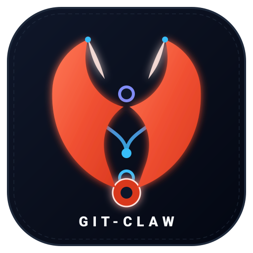

<p align="center">
  
</p>

# git-claw 🦀

> Deterministic Git Worktrees orchestrator for concurrent human and AI development.

[](https://crates.io/crates/git-claw)
[](https://github.com/jeremylanes/git-claw/actions)
[](LICENSE)
[](CHEATSHEET.md)

---

## Overview

When human developers or autonomous AI agents work across multiple Git branches in parallel, they frequently encounter workspace friction: local port collisions (`Address already in use`), container naming conflicts, and redundant dependency installations.

`git-claw` eliminates this overhead through deterministic isolation:

- **Deterministic Slot IDs**: Assigns a sequential numeric slot (`1, 2, 3...`) per active worktree.
- **Collision-Free Port Offsets**: Computes ports deterministically (`Effective Port = Base Port + Slot ID`).
- **Environment Injection**: Generates an isolated `.env.worktree` containing active slot and port definitions.
- **Shared Build Caches**: Reuses dependency directories (`node_modules`, `target`, `.venv`) via symlinks.
- **Auto-Healing Garbage Collection**: Detects removed directories and reclaims slot allocations automatically.
- **Release Automation**: Infers SemVer versioning and updates `CHANGELOG.md` via Conventional Commits.
- **Zero Lock-in**: Works out of the box in any Git repository with no mandatory configuration.

**Reference Guide:** Consult the [Interactive Markdown Cheatsheet](CHEATSHEET.md) or the visual [HTML Cheatsheet](docs/index.html).

---

## Installation

### Via Cargo

```bash
# From crates.io (recommended):
cargo install git-claw

# Or from source:
cargo install --path .
```

Verify installation:
```bash
git-claw --version
```

Because the binary is named `git-claw`, Git automatically registers it as a native subcommand:
```bash
git claw --help
```

---

## Quickstart

Start a new feature worktree in an existing repository with zero setup:

```bash
# 1. Create an isolated worktree for your feature
git claw feature start auth-flow

# 2. Inspect active worktrees and assigned ports
git claw list

# 3. Open in your editor or run commands inside the workspace
git claw open auth-flow
git claw run auth-flow npm run dev

# 4. Publish to remote with upstream tracking
git claw feature publish auth-flow

# 5. Run verification tests, merge into main, and clean up
git claw finish auth-flow
```

---

## Command Reference

| Command | Description |
|---|---|
| `git claw init [-y]` | Initialize or update repository `.git-claw.toml` configuration |
| `git claw list` | List all active worktrees, assigned slots, and computed ports |
| `git claw feature start <name>` | Create and checkout `feature/<name>` in an isolated worktree |
| `git claw bugfix start <name>` | Create and checkout `bugfix/<name>` in an isolated worktree |
| `git claw hotfix start <name>` | Create and checkout `hotfix/<name>` in an isolated worktree |
| `git claw spike start <name>` | Create a disposable experiment worktree |
| `git claw spike drop <name>` | Delete a spike worktree and branch without merging |
| `git claw publish [<name>]` | Push worktree branch to remote with upstream tracking |
| `git claw finish <name>` | Verify tests via hooks, merge into `main`, delete branch, and cleanup |
| `git claw open <name>` | Open worktree directory in default editor (`$EDITOR` or IDE) |
| `git claw run <name> <cmd...>` | Execute a command inside the worktree with `.env.worktree` loaded |
| `git claw cd <name>` | Output physical directory path for shell navigation |
| `git claw tag` | Commitizen-style SemVer bump, changelog update, and annotated release tag |
| `git claw tag <version>` | Create an explicit release tag and synchronize project manifests |
| `git claw completion <shell>` | Generate shell completions (`fish`, `bash`, `zsh`, `powershell`, `elvish`) |

For options and flags, append `--help` to any subcommand.

---

## Configuration

To customize base ports, lifecycle hooks, or shared directories, add a `.git-claw.toml` at repository root:

```toml
[project]
name = "my-service"
main_branch = "main"                     # Default: "main"
worktree_root = "../my-service-worktrees"# Default: "../<repo>-worktrees"

[ports]
# Shifted deterministically by Slot ID (Slot 1 -> 8001, Slot 2 -> 8002)
web = 8000
database = 5432
redis = 6379

[hooks]
post_start = "bin/up"        # Triggered after worktree creation
pre_finish = "cargo test"    # Blocks merge into main if exit code != 0
post_finish = "bin/down"     # Triggered after worktree deletion

[cache]
strategy = "shared"          # "shared" (symlinks) or "isolated"
shared_paths = [".venv", "node_modules", "target"]
```

---

## Automated Releases & Conventional Commits

`git-claw` includes an automated release management engine inspired by Commitizen.

### Automatic Mode
Run `git claw tag` on a clean `main` branch without arguments:
```bash
git claw tag
```

The tool automatically:
1. Inspects commit history since the previous release tag.
2. Infers the SemVer bump level from Conventional Commits:
   - `feat!:` / `BREAKING CHANGE:` -> **MAJOR** (`0.3.0` -> `1.0.0`)
   - `feat:` -> **MINOR** (`0.3.0` -> `0.4.0`)
   - `fix:`, `perf:`, `chore:` -> **PATCH** (`0.3.0` -> `0.3.1`)
3. Generates or updates `CHANGELOG.md` with categorized release notes.
4. Synchronizes project manifests:
   - **Rust**: `Cargo.toml` (and `Cargo.lock` via `cargo check`)
   - **Python**: `pyproject.toml` or `project.toml` (and `uv.lock` via `uv lock`)
5. Commits changes as `chore: release <version>` and creates an annotated Git tag on `main`.

### Explicit Mode
To specify an exact version override:
```bash
git claw tag v1.0.0
```

---

## Shell Integration

### Directory Navigation
Add this helper to `~/.bashrc` or `~/.zshrc` to navigate into worktrees directly with `claw cd`:

```bash
claw() {
    if [ "$1" = "cd" ]; then
        local target
        target=$(git-claw cd "$2") && cd "$target"
    else
        git-claw "$@"
    fi
}
```

### Auto-Completion
```bash
# Fish:
mkdir -p ~/.config/fish/completions
git claw completion fish > ~/.config/fish/completions/git-claw.fish

# Bash:
git claw completion bash > ~/.local/share/bash-completion/completions/git-claw

# Zsh:
git claw completion zsh > ~/.zfunc/_git-claw
```

---

## License

GPL-2.0-only (GNU General Public License v2.0) — identical to the upstream [Git](https://github.com/git/git/blob/master/COPYING) project license. See [LICENSE](LICENSE) for details.
